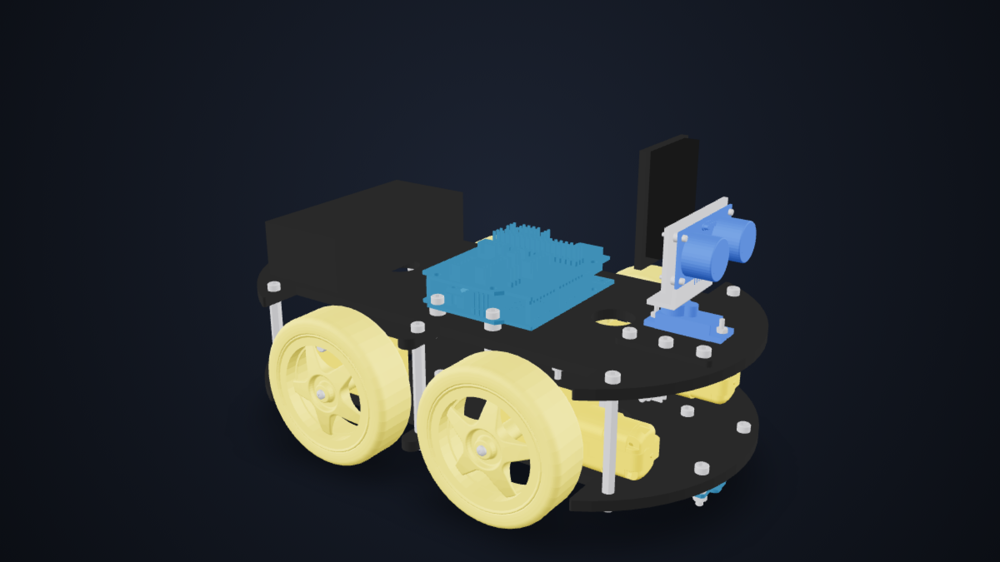
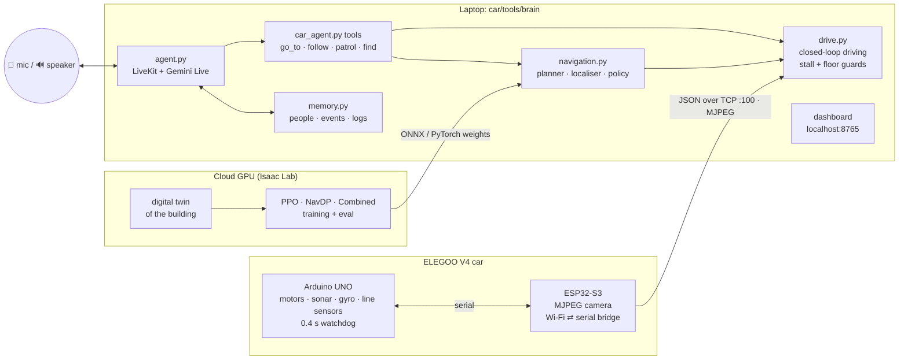

<div align="center">

# Remi

**An off-the-shelf toy robot car kit turned into a talking, seeing, self-driving robot with a personality.**

Voice by Gemini Live · navigation policies trained in an Isaac Sim digital twin · long-term memory · a live web control pane



[](LICENSE)


</div>

---

## What is this?

Remi starts as an off-the-shelf **ELEGOO Smart Robot Car Kit V4.0**: an Arduino UNO, four TT motors, an ultrasonic
sensor on a servo, a gyro, line sensors and an ESP32-S3 camera. Out of the box it follows lines and dodges walls.

This project turns it into a small robot you can just talk to:

> "Hey Remi, go to the kitchen and see if anyone's there."
>
> "I think I'm in the kitchen now. There's someone by the counter. Hi!"

Remi hears you through the Mac's microphone and sees through his own camera. He decides for himself when to
move, drives himself to named rooms, follows people, looks for objects, patrols, and remembers who he has met
from one day to the next. The heavy lifting runs on a laptop and in the cloud. The car keeps only the
safety reflexes that have to be fast.

## Highlights

| | |
|---|---|
| 🗣️ **Realtime voice agent** | [LiveKit Agents](https://github.com/livekit/agents) with **Gemini Live**: one realtime model hears the mic, watches the camera and calls tools to drive. There is also an ElevenLabs STT → Gemini → TTS pipeline. |
| 🧠 **Long-term memory** | Remi keeps the people he's met, the things that happened and a daily conversation log on disk. They're summarised into his instructions at the start of every session, so callbacks work across days. |
| 🗺️ **Go to a named place** | A planner, a particle-filter localiser and learned driving policies take him to "the kitchen" or "home". Dead reckoning (wheels + gyro) puts him on the building map. |
| 🧍 **Skills** | `go_to`, `follow_person`, `find_object`, `patrol`, `explore`, `look_direction`, `where_am_i`, `directions_to`. They run in the background and report back what actually happened. |
| 👁️ **Perception** | ESP32-S3 MJPEG camera, YOLOX-Nano person tracking on the CPU, monocular metric depth (Apple Depth Pro 2-S / Depth Anything V2). |
| 🛑 **Safety first** | A firmware watchdog stops the wheels 0.4 s after commands stop arriving. Forward moves stop at 15 cm (sonar). The stall detector catches wheels spinning in place, and the floor sensors stop him when he's lifted or at an edge. |
| 🖥️ **Control pane** | A browser dashboard with the live camera, sensors, the agent's transcript, the map and manual driving. |
| 🧪 **Sim-to-real pipeline** | iPhone room scan → Isaac Sim digital twin → PPO, NavDP and Depth-Anything policies trained on what the real car can actually sense (latency, dropped frames, sonar dropouts). |
| 🔁 **Real tool-call replay** | `sim/cmdtest` records Gemini's actual tool calls once, then replays them in Isaac Sim against every candidate driver, with the same seeds and the same script. |

## Results

Measured in Isaac Sim on held-out routes, with the inputs modelled on the real car (latency, motion blur, JPEG
artefacts, dropped frames, sonar dropouts):

| Driver | Route success | Contacts / m | Speed |
|---|---:|---:|---|
| **NavDP** (diffusion policy, fine-tuned on this car) | **93.3 %** (240 routes) | **0.0028** | 13.5 decisions/s on an M5 Pro (MPS) |
| **Combined "C"** (frozen Depth Anything V2 + 3 small heads: drive, where-am-I, which-way-to-goal) | 91.7 % (60 routes) | – | 56 decisions/s on CPU, 17.8 ms median |
| PPO driver + safety veto (`go_to` default) | 86 % arrivals (100 trips) | 0.091 bumps/m | 5.5 s/m |
| Hand-written pursuit baseline | 77 % arrivals (100 trips) | – | – |

On the real car:

- **Camera link: 1.2 → 11.2 frames/s.** A firmware fix turns off ESP32 Wi-Fi power-save and the soft-AP once the camera has joined the network. Ping went from 6–316 ms to 5–8 ms.
- **Heading hold** keeps straight runs within about 1.5°, and turns land within about 5° of the target.
- **Dead reckoning** matched the simulated ground truth within 1 cm over a 3.9 m drive.

## How it works



## Repository layout

```text
remi-robot/
├── remi                     # one launcher: ./remi | text | fake | memory | help
├── car/                     # everything that runs on or next to the car
│   ├── *.ino, *.cpp, *.h    #   Arduino UNO firmware (ELEGOO base + this project's protocol and safety changes)
│   ├── esp32s3-camera-wifi/ #   ESP32-S3 camera firmware: joins your Wi-Fi, streams MJPEG, bridges serial
│   └── tools/
│       ├── fw.sh            #   build / backup / flash the UNO
│       └── brain/           #   the robot's brain (Python): agent, tools, driving, navigation, memory, dashboard, tests
└── sim/                     # simulation, training and evaluation
    ├── urdf/, preview/      #   car model rebuilt from CAD (URDF + meshes, GLB preview)
    ├── isaac/               #   Isaac Lab envs: PPO driver, NavDP fine-tune, combined model, scene builders
    ├── models/              #   deployable drivers (driver.py + weight licences), the same API in sim and on the car
    ├── navigate/, localize/ #   planner and particle-filter localiser
    ├── policy/              #   small ONNX driving policies used by go_to
    ├── realdepth/           #   live monocular depth and its observation spec
    ├── cmdtest/             #   replay Gemini's real tool calls through any driver in Isaac
    ├── macsim/              #   lightweight stand-in world for working on a Mac
    └── cloud/               #   scripts for running GPU/CPU jobs on GCP VMs
```

## Quick start

### 1. Try it without hardware

```bash
cd car/tools/brain
python3.12 -m venv .venv && .venv/bin/pip install -r requirements.txt
gcloud auth application-default login           # Gemini via Vertex AI
export GOOGLE_CLOUD_PROJECT=<your-gcp-project>
cd ../../.. && ./remi fake text                 # simulated car + typed chat, dashboard on :8765
```

`./remi fake` starts a stand-in car (`fake_car.py`) with a synthetic camera and room, so you can talk to Remi,
watch the dashboard and run the tests (`.venv/bin/python -m pytest tests`) on a laptop.

### 2. On the real car

1. **Flash the UNO**: `PORT=/dev/cu.usbserial-XXXX car/tools/fw.sh build && car/tools/fw.sh upload`. Set the shield switch to *UPLOAD* while flashing.
2. **Flash the camera**: copy `wifi_secrets.example.h` to `wifi_secrets.h`, add your Wi-Fi details, then build with Arduino-ESP32 2.0.14 (see [`car/esp32s3-camera-wifi/README.md`](car/esp32s3-camera-wifi/README.md)). `wifi_secrets.h` is git-ignored.
3. **Person detector** (3.7 MB, needed for following and patrol sightings):
   ```bash
   mkdir -p car/tools/brain/.venv/share/elegoo && curl -fsSL -o car/tools/brain/.venv/share/elegoo/yolox_nano.onnx \
     https://github.com/Megvii-BaseDetection/YOLOX/releases/download/0.1.1rc0/yolox_nano.onnx
   ```
4. **Run**: `./remi` for voice or `./remi text` to type. The car is found at `elegoo-car.local` by default; set `CAR_HOST` to use another address.

### Configuration

| Variable | Default | What |
|---|---|---|
| `GOOGLE_CLOUD_PROJECT` | – | GCP project for Vertex AI (Gemini) |
| `CAR_VOICE` | `gemini-live` | `gemini-live` or `elevenlabs` |
| `GEMINI_LIVE_MODEL` / `GEMINI_VOICE` | `gemini-3.8-live` / `Sadachbia` | realtime model and voice |
| `ELEVENLABS_API_KEY` | – | only for `CAR_VOICE=elevenlabs` (or read from Secret Manager) |
| `CAR_HOST` / `CAR_PORT` | `elegoo-car.local` / `100` | the car's address |
| `CAR_CAMERA_URL` / `CAR_STREAM_URL` | derived from `CAR_HOST` | still and MJPEG endpoints |
| `DASHBOARD_PORT` | `8765` | control pane |

### Model weights

Weights are attached to the [GitHub release](https://github.com/kristianvast/remi-robot/releases), not stored in git:

```bash
gh release download v0.1.0 -R kristianvast/remi-robot -D /tmp/remi-weights
cp /tmp/remi-weights/navdp_elegoo.pt          sim/models/navdp/weights/
cp /tmp/remi-weights/navdp_elegoo.pt          sim/models/navdp2/weights/
cp /tmp/remi-weights/combined_encoder.onnx    sim/models/combined/weights/encoder.onnx
cp /tmp/remi-weights/combined_encoder.onnx    sim/models/combined2/weights/encoder.onnx
cp /tmp/remi-weights/combined_heads.onnx      sim/models/combined/weights/heads.onnx
cp /tmp/remi-weights/combined_heads.pt        sim/models/combined/weights/heads.pt
```

`SHA256SUMS` in the release lets you verify the downloads. The small ONNX policies in `sim/policy/` ship in the repo.

### Bring your own building

The room scans, floor map and digital-twin scene of the building Remi was trained in are **not** published.
To use maps and `go_to` in your own space:

- Scan it (an iPhone LiDAR capture works).
- Produce `scans/merged/floor_map.png` + `floor_map.yaml` (occupancy image, 0.02 m/px) and `rooms_next.json` (room polygons).
- Name your rooms in `sim/navigate/places.yaml`.

Everything else (voice, driving, following, patrol, memory, the dashboard) works without a map.

## Under the hood: a few things worth knowing

- **The LLM never steers.** Gemini calls blocking skills such as `go_to("kitchen")` or `drive_forward(150)`. Closed-loop control runs on the laptop at the speed of the link (about 14 commands/s over Wi-Fi), and the hard stops live in the firmware.
- **Train on what the car can really sense.** The simulated camera gets the real latency, motion blur, JPEG quality, dropped frames and sonar dropouts (`sim/realdepth/observation_spec.md`), so a policy that scores well in sim stands a fair chance on the carpet.
- **One driver API everywhere.** Every driver implements `act(obs, cmd) -> (left_pwm, right_pwm)` (`sim/cmdtest/DRIVER_API.md`), so the same `driver.py` runs in Isaac, in the Mac stand-in and on the real car.
- **Confidence is not correctness.** The localiser's "bad fit" score drops near furniture even when the pose estimate is right. Separating map mismatch from pose uncertainty stopped good trips from timing out while relocalising.

## Status

This is a hobby project, built fast and shared as-is. The simulator numbers above are measured; real-car
behaviour has been checked for driving, turning, camera and voice, but long `go_to` trips on the real car
are still a work in progress. Issues and PRs are welcome.

## Credits and licence

Built by **[Kristian Vastveit](https://github.com/kristianvast)**, with contributions from
**[David Remenyik](https://github.com/DavidRemenyik)**, who built the ESP32-S3 Wi-Fi camera firmware and the first teleop tools this project grew from. Licensed under the [Apache License 2.0](LICENSE).

It stands on the shoulders of: the ELEGOO Smart Robot Car V4.0 firmware, ArduinoJson,
Espressif's CameraWebServer, [X-NavDP](https://github.com/InternRobotics/NavDP) (MIT), DINOv2 and
[Depth Anything V2](https://github.com/DepthAnything/Depth-Anything-V2) (Apache-2.0), YOLOX (Apache-2.0),
Apple Depth Pro 2 (research licence, optional), LiveKit Agents, Gemini and NVIDIA Isaac Lab. See [NOTICE](NOTICE) for details.
